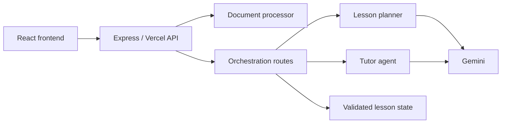
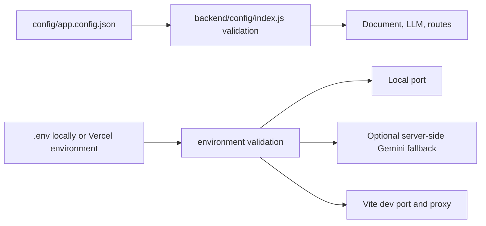
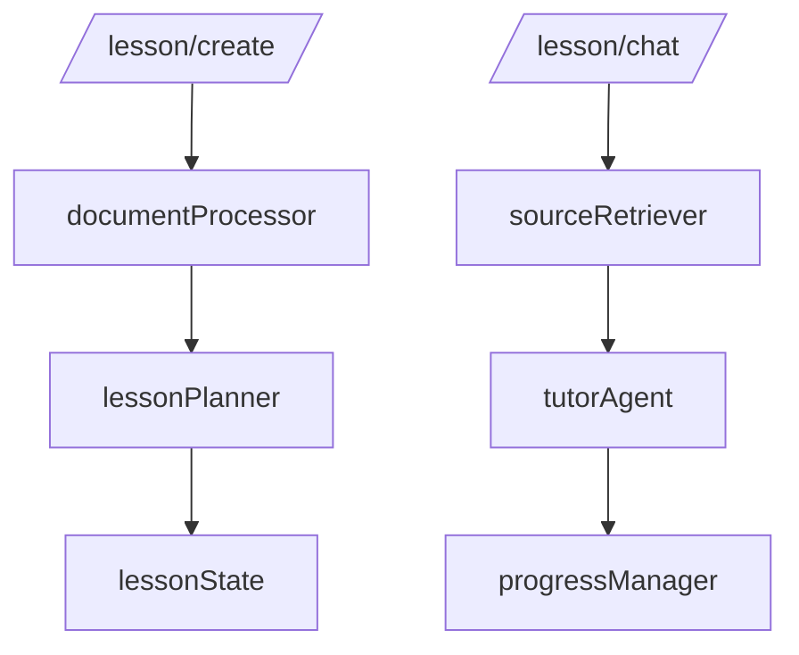
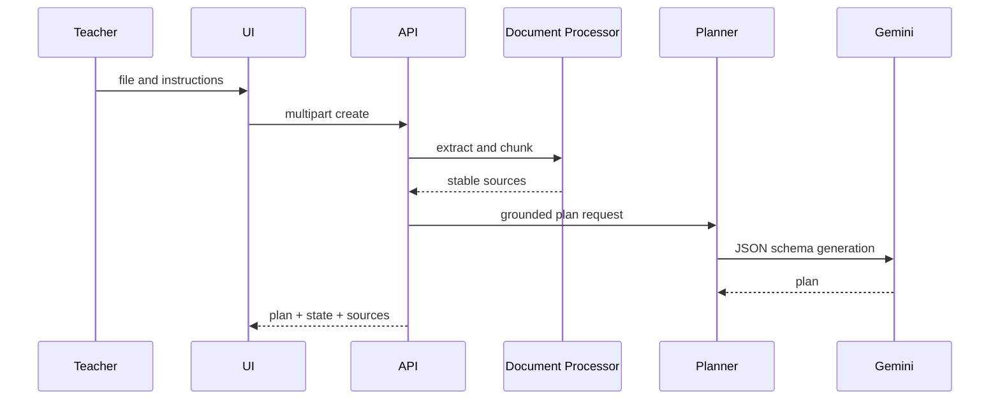
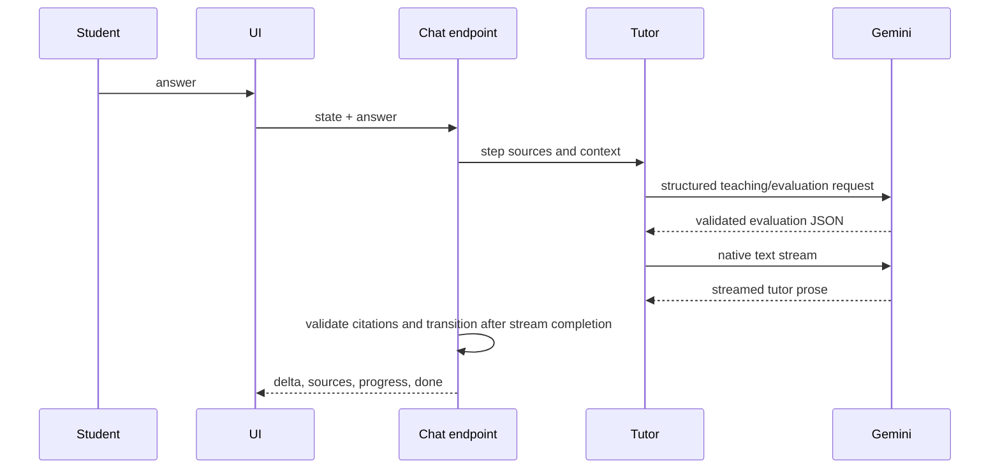
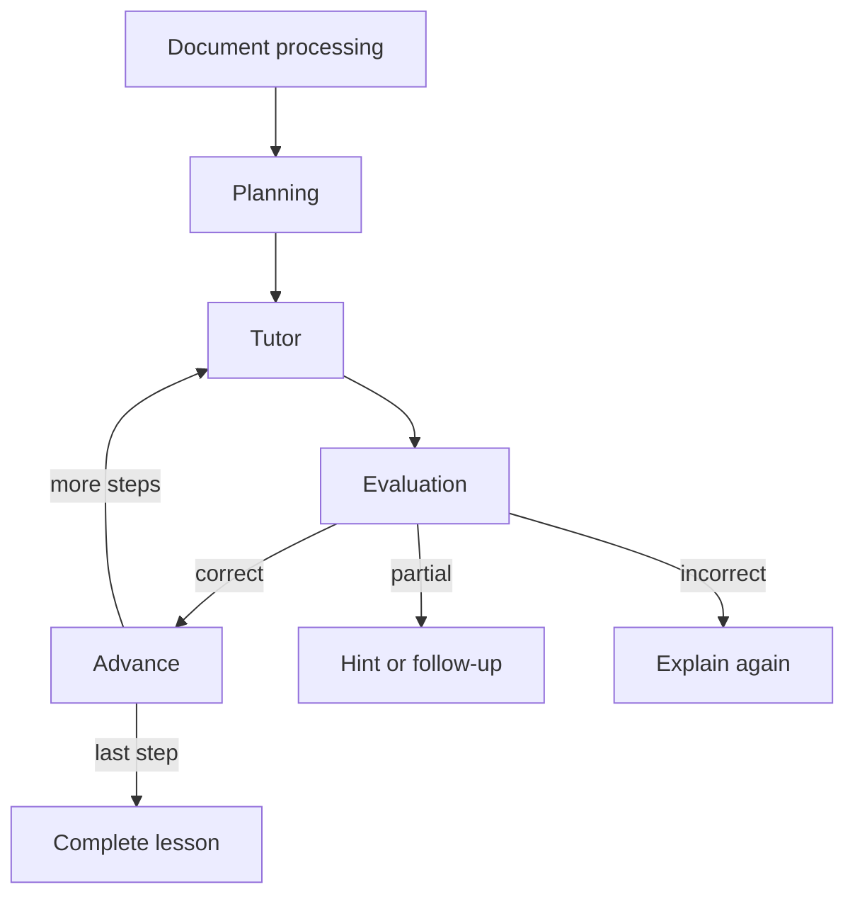
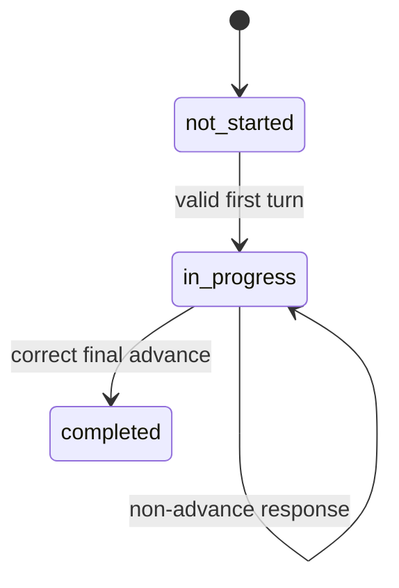

# TeachFlowAI backend

## Architecture overview

The backend accepts source material, produces a grounded lesson plan, and conducts one validated teaching turn at a time. It is stateless: the browser returns `lessonState` on every chat request. That is convenient for the MVP but is not tamper-proof; a production version should sign state or keep it server-side.



Local Vite proxies `/api` to Express on port 3001. Vercel functions are thin adapters importing the same Express app.

## Configuration Architecture

`config/app.config.json` is the single, version-controlled source of non-secret behavior. `backend/config/index.js` imports and validates it once per local process or Vercel function instance; it is never read on each request. Environment values are independently read from `process.env` for runtime location and optional credentials. Environment variables never override JSON behavior values.



| Layer | Key                                                                                                                                | Used by                                                  |
| ----- | ---------------------------------------------------------------------------------------------------------------------------------- | -------------------------------------------------------- |
| JSON  | `ai.provider`, `ai.defaultModel`, `ai.timeoutMs`, `ai.maxOutputTokens`                                                             | Gemini client                                            |
| JSON  | `document.maxFileBytes`, `document.chunkSizeCharacters`, `document.chunkOverlapCharacters`                                         | upload and chunking                                      |
| JSON  | `lesson.maxSteps`, `lesson.maxSourceContextCharacters`                                                                             | planner and retrieval                                    |
| JSON  | `input.maxTeacherPromptCharacters`, `input.maxStudentMessageCharacters`, `input.maxConversationMessages`, `input.maxJsonBodyBytes` | request validation                                       |
| ENV   | `BACKEND_PORT`                                                                                                                     | local Express listener (default `3001`)                  |
| ENV   | `VITE_DEV_PORT`                                                                                                                    | Vite dev server only (default `5173`)                    |
| ENV   | `BACKEND_PROXY_TARGET`                                                                                                             | Vite `/api` proxy only (default `http://localhost:3001`) |
| ENV   | `GEMINI_API_KEY`                                                                                                                   | optional backend fallback only                           |

Request-provided API keys take precedence over the optional `GEMINI_API_KEY` fallback. Neither is persisted, logged, passed to Vite, or included in responses. Production uses Vercel Environment Variables; it does not depend on a local `.env` file. Only Vite's configuration process reads development proxy settings, so production routing remains Vercel's responsibility.

## API endpoints

| Method | Path                 | Content type          | Purpose                                                                                                                           |
| ------ | -------------------- | --------------------- | --------------------------------------------------------------------------------------------------------------------------------- |
| GET    | `/api/health`        | —                     | Returns `{ status: "ok", service: "TeachFlowAI" }` without AI.                                                                    |
| POST   | `/api/lesson/create` | `multipart/form-data` | Requires `file`, `teacherPrompt`, `apiKey`; optional `model`. Returns plan, sources, coverage note, and client-held lesson state. |
| POST   | `/api/lesson/chat`   | JSON                  | Requires `lessonId`, `lessonState`, `conversationHistory`, `apiKey`, and either `message` or `start: true`. Streams SSE.          |



Create errors use `{ "error": { "code", "message", "requestId" } }`; common codes include `MISSING_FILE`, `FILE_TOO_LARGE` (413), `UNSUPPORTED_FILE` (415), `EMPTY_DOCUMENT`, `MISSING_API_KEY`, and safe AI-provider errors. The `requestId` is safe to copy from an error response or `X-Request-ID` header to correlate it with backend logs.

Chat SSE events are `delta` (`{text}`), `sources` (`{sourceIds}`), `progress` (`{progress, lessonState}`), `done`, and `error` (`{error: {code, message, requestId}}`). Metadata is never included in `delta`. A disconnected client ends before state is emitted, so it cannot commit progress.

## Lesson creation



TXT and text PDFs up to 4 MB are supported. Each chunk receives `chunk_n`; the planner’s source IDs are checked against them. Image-only/scanned PDFs fail with a clear OCR message. All extractable content is chunked, then each tutoring request caps selected context at 8,000 characters.

## Interactive teaching



Each tutor turn makes two Gemini requests: a schema-validated evaluation returns `understanding`, `action`, `shouldAdvance`, and citations; then a native stream produces only student-facing prose. Only a `correct`/`advance` evaluation can progress, and progress is emitted only after the prose stream completes. This prevents partial streamed output from mutating lesson state.

## Agentic workflow and state machine



This is a small multi-stage workflow, not an autonomous agent framework: each stage has a narrow typed input/output. `not_started` moves to `in_progress` after a valid turn. A correct advance completes the final step; invalid, incorrect, or cancelled turns cannot advance.



## Project structure

```text
backend/
  agents/ lessonPlanner.js, tutorAgent.js
  lesson/ lessonState.js, progressManager.js
  routes/ health.js, createLesson.js, chatLesson.js
  services/ documentProcessor.js, sourceRetriever.js, llmClient.js
  app.js  local.js  errors.js
api/ health.js, lesson/create.js, lesson/chat.js
```

## Security, reliability, and deployment

API keys are per-request only and are neither persisted nor logged. Uploads, prompts, messages, histories, schemas, model names, source IDs, and state transitions are bounded/validated. Source text is labelled untrusted in prompts to reduce instruction injection. Gemini errors are mapped to safe errors. Vercel body/function limits may be stricter than the local 4 MB limit; confirm limits in the chosen Vercel plan before production.

## Commands and limitations

`npm install`, `npm run dev`, `npm test`, `npm run check`, and `npm run build` run install, local app, backend tests, checks, and client build. Deploy with `vercel --prod` after configuring a project; deployment was not performed here.

Limitations: no OCR, no server-side integrity/rate limiting, document chunk retrieval is deterministic rather than semantic, and structured generation is buffered before SSE. Add signed/server-side state, OCR, observability, rate limits, and true provider streaming with a robust metadata framing protocol for production.
