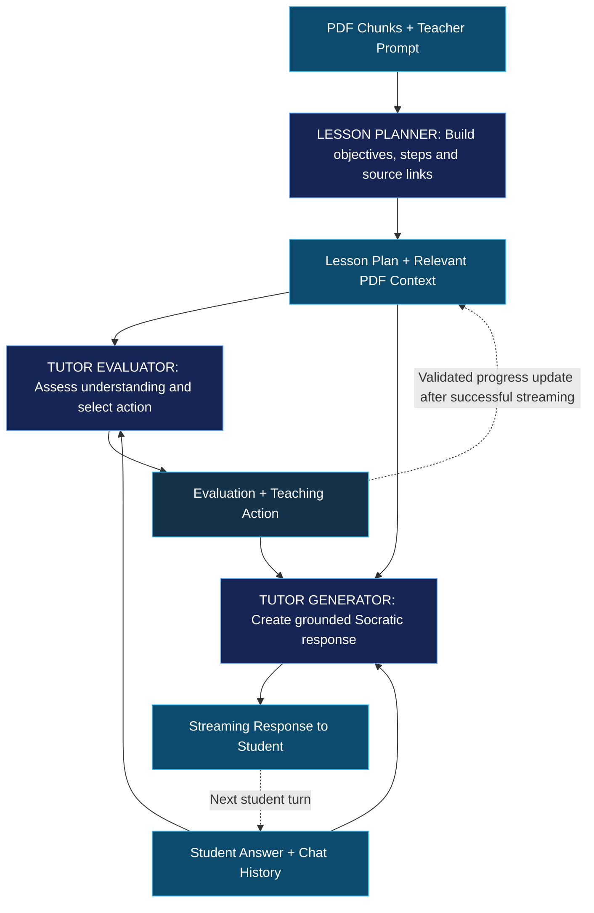

# TeachFlowAI — Agentic Flow Architecture

## Overview

TeachFlowAI uses an **orchestrated agentic workflow** to transform uploaded educational material into an interactive, adaptive learning experience.

The architecture separates three main AI operations:

1. **Lesson Planner** — Creates a structured learning path based on the uploaded document and teacher instructions.
2. **Tutor Evaluator** — Evaluates student understanding and determines the next teaching action.
3. **Tutor Generator** — Generates a personalized, source-grounded teaching response.

These operations are coordinated by the application rather than functioning as fully autonomous agents.

The main goal is to combine **structured lesson planning, adaptive teaching, and controlled progress tracking**, while minimizing unnecessary LLM calls and maintaining traceability to the original document.

---

## Agentic Flow Diagram

The diagram represents the complete AI workflow, from the initial document context to the recurring student interaction loop.

The Lesson Planner runs during lesson creation, while the Tutor Evaluator and Tutor Generator run on each student turn.

---

## 1. Document Context — Preparing the AI Input

### What enters the workflow?

The workflow starts with two main inputs:

- **PDF Chunks:** Text extracted from the uploaded educational document.
- **Teacher Prompt:** Instructions defining how the lesson should be taught.

Examples of teacher instructions include:

- Teach the material to 7th-grade students.
- Use a Socratic teaching approach.
- Explain concepts in Hebrew.
- Keep explanations short.
- Ask questions to check understanding.

### How does it work?

After text extraction, the application divides the document into smaller, overlapping text chunks.

Each chunk contains:

- A unique source ID.
- The extracted text.
- The original page number.

The document chunks are stored in the application's structured lesson state.

The frontend holds this state in React and sends it to the backend when needed.

The system does not use a vector database or embeddings.

Instead, it relies on **Source-ID-Based Retrieval**.

Each lesson step references relevant document chunks through source IDs, allowing the backend to retrieve the passages needed for the current teaching objective.

### Why this approach?

This approach was selected to keep the implementation simple, lightweight, and cost-efficient.

It provides:

- Traceability to the original document.
- Smaller prompts for the Tutor.
- No dependency on external database infrastructure.
- Predictable source retrieval.
- Reduced processing and embedding costs.

**Trade-off:** Retrieval is based on predefined source references rather than semantic similarity. Its effectiveness depends on the quality and coverage of the initial lesson plan.

---

## 2. Lesson Planner — Creating the Learning Path

### Role

The Lesson Planner is responsible for transforming document content into a structured lesson plan.

It runs once when a new lesson is created.

### Input Context

The Lesson Planner receives:

- Teacher instructions.
- Selected PDF chunks.
- Available source IDs.
- Lesson length configuration.

### What does it do?

The Planner makes a structured LLM request to analyze the supplied educational content.

It identifies the important learning objectives and organizes them into a logical sequence.

For each lesson step, it defines:

- What the student should learn.
- The step's learning objective.
- Which source passages support the objective.

The generated plan is validated before being used.

### Output

The Planner produces a structured **Lesson Plan**, including:

- Lesson title.
- Teaching language.
- Learning objectives.
- Ordered lesson steps.
- Source references for each step.

The application stores this plan in the structured lesson state.

### Why separate planning from tutoring?

Creating the lesson plan once provides a consistent educational structure.

Without this separation, the Tutor would need to reconsider the complete learning sequence during every conversation turn.

A dedicated planning stage provides:

- A stable learning path.
- Lower repeated LLM costs.
- Better progress tracking.
- Easier debugging.
- Clear separation of responsibilities.

The Tutor can adapt its explanations without rebuilding the entire lesson.

---

## 3. Tutor Evaluator — Evaluating Student Understanding

### Role

The Tutor Evaluator determines how well the student understands the current lesson objective.

It acts as a **student-understanding evaluator**, using an LLM-as-a-Judge-style pattern.

Importantly, it evaluates the student's understanding, not the quality of the Tutor Generator's output.

### Input Context

The Evaluator receives:

- Current lesson objective.
- Relevant PDF passages.
- Teacher instructions.
- Student's latest message.
- Conversation history.

### What does it do?

The Evaluator analyzes the student's response in the context of the current learning objective.

It classifies the student's understanding into one of four categories:

| Classification | Meaning |
|---|---|
| `correct` | The student demonstrates sufficient understanding. |
| `partial` | The student understands part of the concept. |
| `incorrect` | The student demonstrates a misunderstanding. |
| `unclear` | The student's response does not clearly demonstrate understanding. |

It also proposes the next teaching action.

Possible actions include:

- `continue` — Continue teaching the current concept.
- `give_hint` — Provide a hint.
- `ask_followup` — Ask another question.
- `advance` — Move to the next lesson step.

### Output

The Evaluator returns a structured evaluation containing:

- Understanding classification.
- Recommended teaching action.
- Advancement recommendation.
- Relevant source IDs.

The application validates the evaluation before applying progress changes.

For example, advancement is not allowed unless the student's answer is classified as correct and the selected action permits advancement.

### Why use a separate Evaluator?

Separating evaluation from generation creates a clear distinction between two responsibilities:

**Deciding what the student needs** and **deciding how to explain it**.

This provides more controlled lesson progression.

It also makes the educational decision explicit instead of hiding it inside a generated chat response.

---

## 4. Tutor Generator — Generating the Teaching Response

### Role

The Tutor Generator creates the response that the student sees.

It uses the Evaluator's decision to determine how to teach the next part of the lesson.

### Input Context

The Tutor Generator receives:

- Teacher instructions.
- Current lesson objective.
- Relevant PDF chunks.
- Student's latest message.
- Conversation history.
- Validated evaluation and teaching action.

### What does it do?

The Generator makes a separate LLM request and streams the generated answer.

It follows the teacher's instructions while adapting the response to the student's understanding.

Examples:

**Correct Answer**

The Generator acknowledges the student's understanding and may introduce the next learning objective when advancement is permitted.

**Partially Correct Answer**

The Generator provides a hint or asks a guiding question.

**Incorrect Answer**

The Generator explains the misconception and helps the student reconsider the answer.

**Unclear Answer**

The Generator asks a clarification or follow-up question.

The Generator is instructed to remain grounded in the relevant PDF context.

### Output

The result is a personalized teaching response streamed to the frontend.

The application uses **Server-Sent Events (SSE)** so the student can see the response progressively rather than waiting for the complete answer.

### Why separate generation from evaluation?

The Generator can focus entirely on producing a clear, natural, educational response.

It does not need to independently decide whether the student should advance.

This improves separation of concerns and makes the tutoring workflow easier to maintain.

---

## 5. Feedback Loop — Adaptive Learning

The Tutor uses a repeated evaluation and generation cycle.

### How the loop works

1. The student submits an answer.
2. The application retrieves the relevant lesson context.
3. The Tutor Evaluator assesses student understanding.
4. The application validates the evaluation.
5. The Tutor Generator produces a teaching response.
6. The response is streamed to the student.
7. After successful streaming, the application applies the validated progress update.
8. The next student message begins another evaluation and generation cycle.

### How progress is managed

Student progress is stored as structured application state.

This state contains information such as:

- Current lesson step.
- Lesson plan.
- Progress information.
- Source passages.

The LLM may recommend advancement, but the application controls the final state transition.

This prevents lesson progression from depending entirely on unconstrained model-generated text.

### Why this matters

A student may need several attempts to understand a concept.

The feedback loop allows the Tutor to remain on the same objective, provide additional guidance, and only advance when the evaluation supports progression.

The architecture therefore supports **adaptive teaching rather than a fixed sequence of explanations**.

---

## 6. Why This Architecture?

### 6.1 Separation of Responsibilities

Each AI component has a focused responsibility:

- **Planner:** What should be taught?
- **Evaluator:** What does the student understand?
- **Generator:** How should the Tutor respond?

This separation makes the workflow easier to understand, test, and improve.

### 6.2 Structured and Adaptive Learning

The Planner creates a consistent educational path.

The Tutor dynamically adapts to the student's answers without changing the entire curriculum.

This combines structured learning with personalized interaction.

### 6.3 Grounded Responses

Teaching steps are linked to document source IDs.

The Tutor receives selected source passages rather than relying only on general model knowledge.

This improves traceability and supports source-grounded explanations.

### 6.4 Controlled Progression

The Evaluator recommends the next teaching action.

Application-side validation controls whether lesson progress can actually change.

This creates a clearer boundary between AI recommendations and application state.

### 6.5 Cost and Latency Trade-offs

The Planner runs once per lesson, reducing repeated planning costs.

The Tutor uses separate evaluation and generation calls, which increases the number of requests but improves the clarity of pedagogical decisions.

Source-based context selection limits the amount of document content included in each request.

---

## 7. Architecture Limitations

### No Output Quality Judge

The current workflow does not include an additional LLM that reviews the Tutor Generator's completed response.

The Evaluator assesses student understanding before response generation.

It does not evaluate the generated response afterward.

A future improvement could introduce an **Output Quality Judge** to validate:

- Factual grounding.
- Compliance with teacher instructions.
- Educational usefulness.
- Language and difficulty level.

However, this would introduce additional cost and latency and complicate streaming.

### No Semantic Retrieval

The application uses deterministic source-ID retrieval rather than a vector database.

This avoids infrastructure complexity but limits the ability to retrieve semantically related passages outside the referenced source set.

### Client-Side State

The lesson plan, sources, and progress are maintained in frontend application state.

The backend receives the required state with requests.

There is no persistent server-side lesson database in the current design.

### Limited Autonomy

The workflow is orchestrated by application code.

The components do not independently communicate, dynamically select tools, or autonomously redesign the entire workflow.

This is a deliberate design choice that prioritizes simplicity, predictability, and maintainability.

---

## 8. Potential Future Improvements

With additional development time, the workflow could be extended with:

1. **Output Quality Judge:** Review Tutor-generated responses before delivery.
2. **Semantic Retrieval:** Use embeddings and a vector database for more flexible document retrieval.
3. **Persistent Lesson Storage:** Save lessons and progress across sessions.
4. **Adaptive Lesson Replanning:** Update learning objectives based on repeated student difficulties.
5. **Evaluation Metrics:** Measure teaching quality, grounding, and student progression across test scenarios.

These improvements are not required for the current workflow but represent possible future extensions.

---

## 9. Code References

| Responsibility | Implementation |
|---|---|
| Document extraction and chunking | `backend/services/documentProcessor.js` |
| Source retrieval and validation | `backend/services/sourceRetriever.js` |
| Lesson Planner | `backend/agents/lessonPlanner.js` |
| Tutor evaluation and generation | `backend/agents/tutorAgent.js` |
| Lesson creation endpoint | `backend/routes/createLesson.js` |
| Chat orchestration and streaming | `backend/routes/chatLesson.js` |
| Progress management | `backend/lesson/progressManager.js` |
| Lesson state | `backend/lesson/lessonState.js` |
| Frontend stream handling | `frontend/src/hooks/useChatStream.js` |

---

## Conclusion

TeachFlowAI uses an orchestrated agentic architecture that separates **lesson planning, student-understanding evaluation, and teaching response generation**.

The Planner establishes a structured learning path, while the Evaluator and Generator work together to adapt each interaction to the student's understanding.

By combining document-grounded context, explicit pedagogical evaluation, deterministic progress validation, and streaming responses, the system provides an adaptive learning experience without the complexity of a fully autonomous multi-agent architecture.
