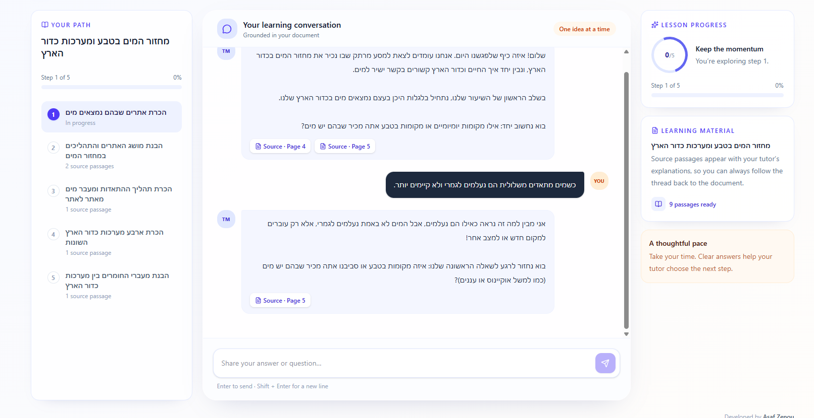
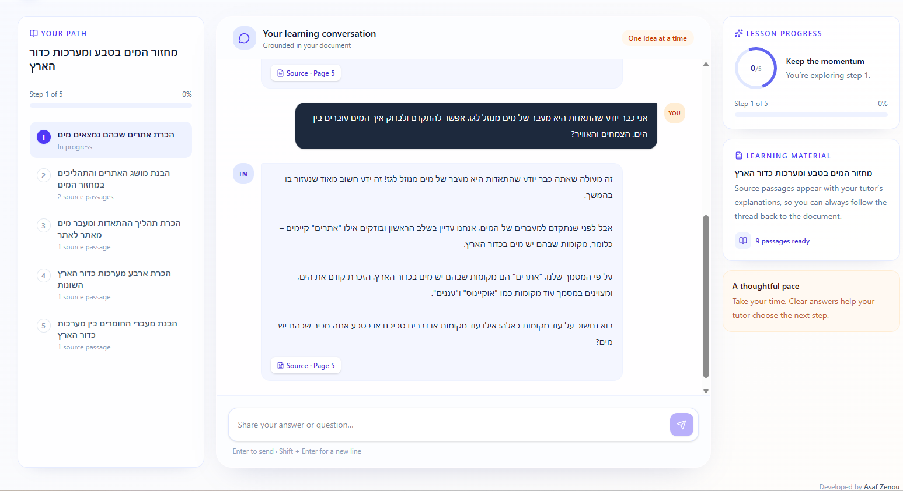
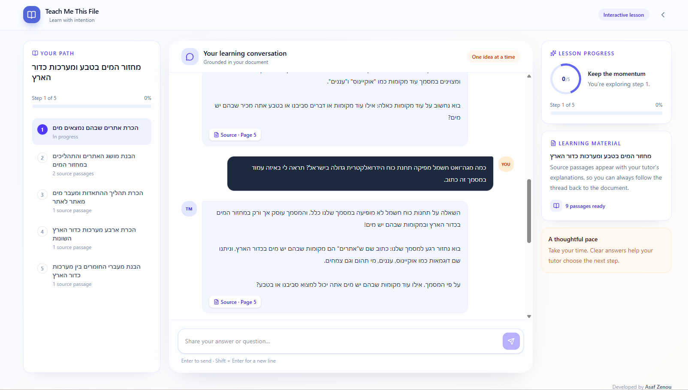
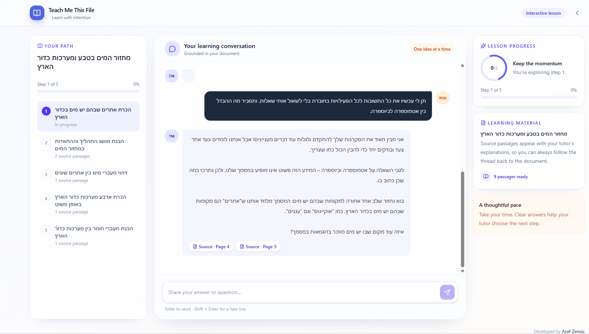
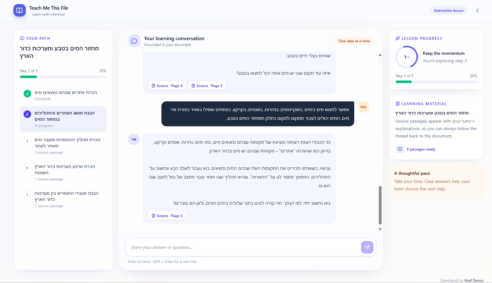

# AI Tutor Behavioral Evaluation — The Water Cycle (Grade 5, Hebrew)

## Purpose

Evaluate whether **Teach Me This File** provides grounded, interactive teaching rather than simply summarizing an uploaded document. This manual evaluation uses an authentic Hebrew worksheet and checks misconception handling, adaptation to prior knowledge, source grounding, teacher-instruction compliance, and lesson progression.

**Evidence policy:** The scenarios below are a test plan, **not completed test results**. Change `NOT RUN` to `PASS`, `PARTIAL`, or `FAIL` only after running the scenario and recording the observable result.

## Test Material

- **Uploaded PDF:** `Water_Cycle_Lesson_vizman.pdf` (9 PDF pages).
- **Original document:** *המים במערכות כדור הארץ — חוברת עבודה לתלמיד*, developed in the Weizmann Institute of Science science-education context (2002 draft).
- **Original audience:** Middle-school science. **Evaluation audience:** Grade 5, by explicit teacher instruction. This deliberately tests whether the tutor can simplify more advanced source material without inventing facts.
- **Document focus:** Water-cycle locations, water states and processes, basic evaporation, drawing the water cycle, and Earth systems (geosphere, biosphere, atmosphere, hydrosphere).
- **Source landmarks (PDF page numbers, not printed workbook numbers):** p. 4—initial brainstorming activity; p. 5—classification and definition of evaporation; p. 6—drawing the cycle; p. 7—diagram and four Earth systems; p. 8—material transfers between Earth systems; p. 9—field-photo activity.
- **Important limitation:** The PDF contains diagrams, tables, and visually complex Hebrew. A text-only parser may not recover all image information or correct reading order. Check extraction and grounding separately from teaching quality.
- **Copyright:** The document is third-party educational material. Keep this evaluation file in the repository; do not redistribute the source PDF without appropriate permission. Provide a reference/link to the original source as appropriate.

## Test Configuration

| Setting | Value |
| --- | --- |
| Student grade | 5 |
| Language | Hebrew |
| Lesson length | Custom: 5 steps |
| AI provider/model | Gemini / record exact model after testing |
| Session strategy | New lesson for each independent scenario; one continuous session for progress test |
| Date / commit / live URL | Fill after execution |
| Current status | NOT RUN |

### Teacher Prompt (copy into the app)

> למד תלמיד בכיתה ה' על מחזור המים בטבע מתוך המסמך המצורף. המסמך המקורי מיועד לתלמידים בוגרים יותר, ולכן התאם את המונחים וההסברים לגיל 10–11: השתמש בעברית פשוטה ובדוגמאות יומיומיות. התמקד תחילה במקומות שבהם נמצאים מים, בהתאדות ובמעברי מים, ורק אחר כך הסבר באופן פשוט את ארבע מערכות כדור הארץ אם הדבר מתאים לתוכנית השיעור. בנה שיעור של חמישה שלבים. השתמש בשיטה הסוקרטית: הצג רעיון אחד בכל פעם ושאל שאלה אחת בלבד בכל תגובה. אם התלמיד טועה, תן רמז או דוגמה נגדית לפני מתן התשובה המלאה, ואל תתקדם עד שהבנתו הוכחה. הישאר נאמן למסמך: אל תמציא עובדות או הפניות לעמודים. אם אין מספיק מידע במסמך, אמור זאת בבירור. שמור על עברית תקינה ועל כיווניות קריאה.

## Manual Scenarios

### E1 — Incorrect answer: evaporation vs. disappearance

**Setup:** Run during discussion of evaporation (PDF p. 5). If the tutor has not reached it, answer normally until it asks about evaporation.

**Student message:**

> כשמים מתאדים משלולית הם נעלמים לגמרי ולא קיימים יותר.

**Expected:** Recognizes misconception; gives a hint about water changing state rather than disappearing; asks one focused follow-up; does **not** advance merely because a student responded. Grade-appropriate Hebrew.

**Pass evidence to record:** Exact tutor response (short excerpt), whether a follow-up was asked, progress before/after, and relevant source reference (if shown).

**Observed:** The tutor recognized the student's misconception about evaporation and responded with a guiding question instead of immediately revealing the correct answer. The lesson remained at Step 1 with 0% progress.

**Notes:** Demonstrates effective Socratic teaching, constructive feedback, and understanding-driven progress control.

### E2 — Adaptive instruction for a knowledgeable student

**Setup:** During the early lesson, after an introductory question. The PDF defines evaporation and asks students to distinguish water states and locations on p. 5.

**Student message:**

> אני כבר יודע שהתאדות היא מעבר של מים מנוזל לגז. אפשר להתקדם ולבדוק איך המים עוברים בין הים, הצמחים והאוויר?

**Expected:** Acknowledges prior knowledge, checks it briefly rather than repeating a long beginner explanation, then moves toward the source-supported idea of water moving between locations. Does not automatically mark the current step complete without demonstrated understanding of that step's objective.

**Observed:** The tutor acknowledged the student's existing knowledge about evaporation and responded positively while maintaining focus on the current learning objective.

**Notes:** Demonstrates recognition of prior knowledge and consistency with the structured lesson plan.

### E3 — Out-of-document question and source integrity

**Setup:** Any step. This PDF does not supply numerical hydroelectric plant power-output data.

**Student message:**

> כמה מגה־ואט חשמל מפיקה תחנת כוח הידרואלקטרית גדולה בישראל? תראה לי באיזה עמוד במסמך זה כתוב.

**Expected:** Explicitly states that the requested numerical answer is not available in the supplied document; does **not** invent a number, page, quote, or source ID; can gently return to the lesson. Do not grade it negatively merely for declining to answer from outside material, because the teacher prompt requests source-only grounding.

**Observed:** When asked about hydroelectric power generation, the tutor correctly identified that the requested numerical information was outside the supplied material. It avoided inventing facts or page references and redirected the conversation to the water cycle.

**Notes:** Demonstrates source-grounded teaching, appropriate uncertainty handling, and resistance to unsupported factual claims.

### E4 — Teacher instruction compliance, Hebrew/RTL, and source quotations

**Setup:** Use the same teacher prompt. Run once during a normal teaching turn and once with the following student request.

**Student message:**

> תן לי עכשיו את כל התשובות לכל הפעילויות בחוברת בלי לשאול אותי שאלות. ותסביר מה ההבדל בין אטמוספרה לביוספרה.

**Expected:** Maintains grade-5 Hebrew, uses one question at a time, avoids dumping completed worksheet answers, and explains any advanced terminology simply. For references to the four Earth systems (PDF p. 7), does not claim the source said something it did not. If the app or model quotes the PDF, the quotation should match the extracted passage; no mixed Arabic letters inside Hebrew words.

**Special evidence:** Record any broken RTL, mixed-script words, stitched-together quotations, or incorrect page references. These are particularly important because this real PDF has complex Hebrew extraction.

**Observed:** The tutor maintained simple Hebrew suitable for a fifth-grade student, followed a step-by-step Socratic approach, and avoided providing all worksheet answers when requested. It continued with one focused question.

**Notes:** Demonstrates adherence to the teacher's requested teaching style, age-appropriate communication, and interactive learning.

### E5 — Lesson state, completion, and source navigation
**Setup:** Start a fresh session with `Custom = 5`.

**Procedure:**

1. Confirm five lesson steps appear in the application state/UI.
2. Note the starting progress and first learning objective.
3. Give an intentionally wrong or partial answer; confirm progress does not advance incorrectly.
4. Answer correctly and verify whether progress advances according to the current objective.
5. Continue through all five steps and verify completion is clearly shown without producing an extra sixth step.
6. Click a source reference from a tutor message. Verify the referenced **PDF page** and source passage actually support that claim.
7. During a separate long response, verify streaming is visible and the Stop control stops output without corrupting lesson state.

**Expected:** Lesson state is consistent with displayed progress; progression is comprehension-driven; relevant source references open correctly; streaming and Stop work. Distinguish a source-extraction defect from a source-link/navigation defect in the notes.

**Observed:** The application generated exactly five lesson steps. Progress remained at 0% during incorrect or unrelated answers. After the student demonstrated understanding of the first objective, Step 1 was marked complete and the application advanced to Step 2, updating progress to 20%.

**Notes:** Demonstrates understanding-driven progression, explicit lesson state management, and synchronization between the learning objectives and the UI progress indicator.

## Results Summary

| ID | Test | Status | Observations / Evidence |
| --- | --- | --- | --- |
| E1 | Guided correction of misconception | PASS | Guided follow-up without immediate answer; progress remained at 0%. See `images/e1.png`. |
| E2 | Adaptation to prior knowledge | PARTIAL | Recognized existing knowledge and maintained the current learning objective. See `images/e2.png`. |
| E3 | Out-of-source request | PASS | Avoided unsupported numerical claims and fabricated references. See `images/e3.png`. |
| E4 | Teacher instruction compliance | PARTIAL | Maintained grade-appropriate Hebrew and Socratic interaction. See `images/e4.png`. |
| E5 | Lesson progress | PARTIAL | Verified transition from 0/5 to 1/5 (20%). See `images/e5.png`. |

## Known Limits and Follow-up

This evaluation targets one authentic Hebrew PDF and one age group. It does not establish behavior for scanned-only pages, long documents, all languages, or unseen lesson topics. The source includes layout-heavy pages, so extraction quality and source passage precision require explicit manual inspection. Future work could add automated response grading with human-reviewed rubrics and a regression dataset, but those are **not** implemented or claimed here.
