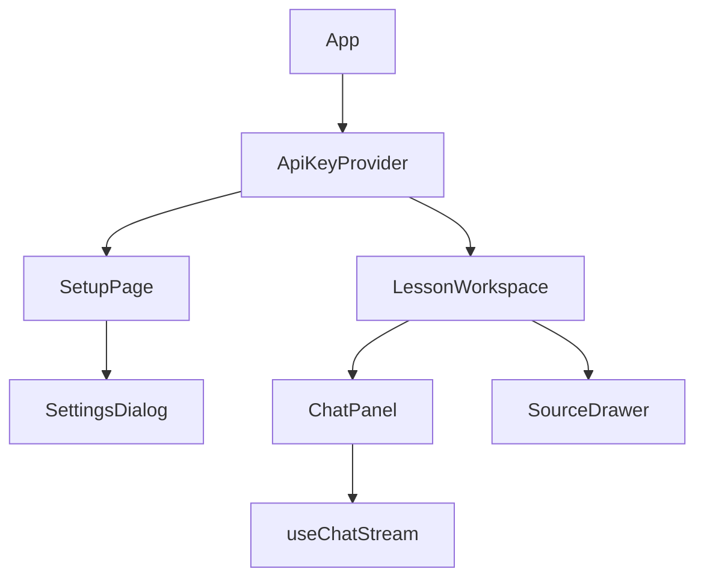
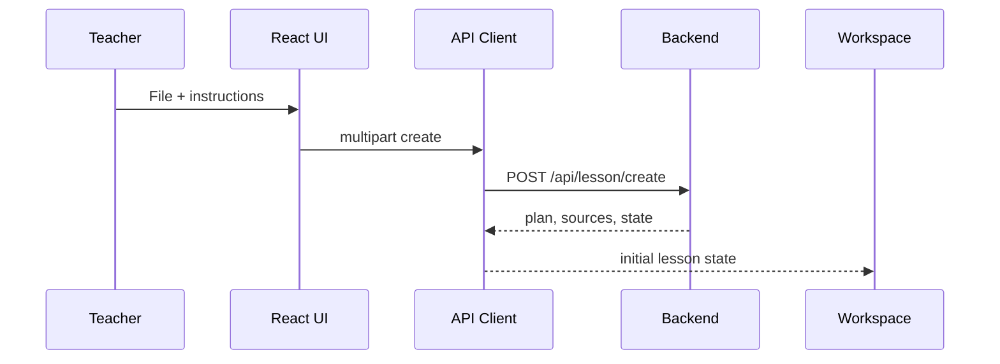
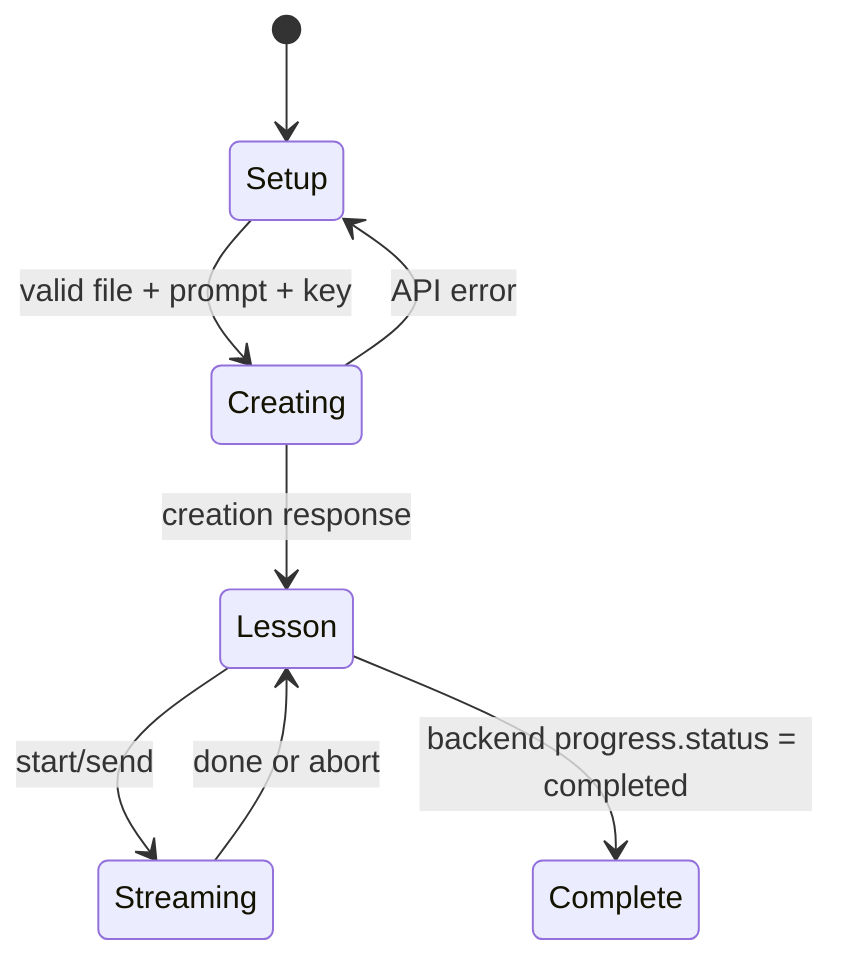

# TeachFlowAI frontend architecture

## Overview

The React/Vite client turns a teacher-uploaded PDF or TXT document into an interactive, backend-grounded lesson. `ApiKeyContext` holds an optional Gemini key only in memory. Lesson state, progress and source chunks are kept separate from chat messages; the backend's `progress` SSE event is authoritative.

## Component tree



## API integration

| Endpoint                  | Request                                                                                                                        | Response used by UI                                                                                        |
| ------------------------- | ------------------------------------------------------------------------------------------------------------------------------ | ---------------------------------------------------------------------------------------------------------- |
| `POST /api/lesson/create` | `multipart/form-data`: `file`, `teacherPrompt`, optional `apiKey`, optional `model`                                            | `201 { lessonId, lessonState, coverage }` (the state is the canonical plan, sources, and progress)         |
| `POST /api/lesson/chat`   | JSON: `lessonId`, `lessonState`, `conversationHistory`, either `start: true` or `message`, optional `apiKey`, optional `model` | SSE: `delta {text}`, `sources {sourceIds}`, `progress {progress, lessonState}`, `done {}`, `error {error}` |

Errors are read from the backend's `{ error: { code, message } }` envelope. The UI sends a key only in create/chat requests and never persists it.

## Lesson creation flow



## Streaming chat flow

```mermaid
sequenceDiagram
  participant Student
  participant Chat as Chat UI
  participant API as API Client
  participant Backend
  participant Parser as SSE Parser
  Student->>Chat: Start or send answer
  Chat->>API: POST /api/lesson/chat
  API->>Backend: JSON request
  Backend-->>Parser: delta / sources / progress / done
  Parser-->>Chat: incremental message updates
  Parser-->>Chat: validated progress + lessonState
  Student->>Chat: Stop
  Chat->>API: AbortController.abort()
  API-->>Chat: preserves visible text; no progress commit
```

## State architecture



Setup state lives in `SetupPage`; the API key is in `ApiKeyContext`; lesson plan/sources/client state and backend progress live in `LessonWorkspace`; messages and request lifecycle live in `useChatStream`.

## Responsive and RTL behavior

Desktop shows a persistent lesson-plan sidebar and centered chat. Mobile exposes the plan as a dialog and sources as a full drawer. Dynamic message and source text use `dir="auto"` and logical flex layout, so Hebrew and Arabic content remain readable.

## Known limitations

The backend buffers Gemini output before emitting chunks, so visible streaming begins after provider generation completes. It supports TXT and text-extractable PDF only; scanned PDFs require OCR. Backend lesson state is client-held and therefore not tamper-proof.
